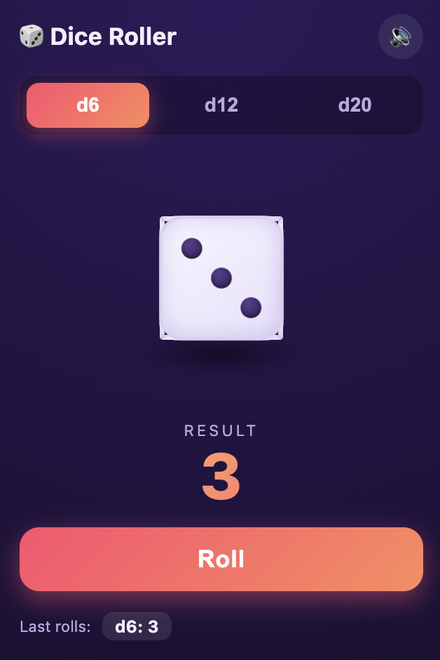
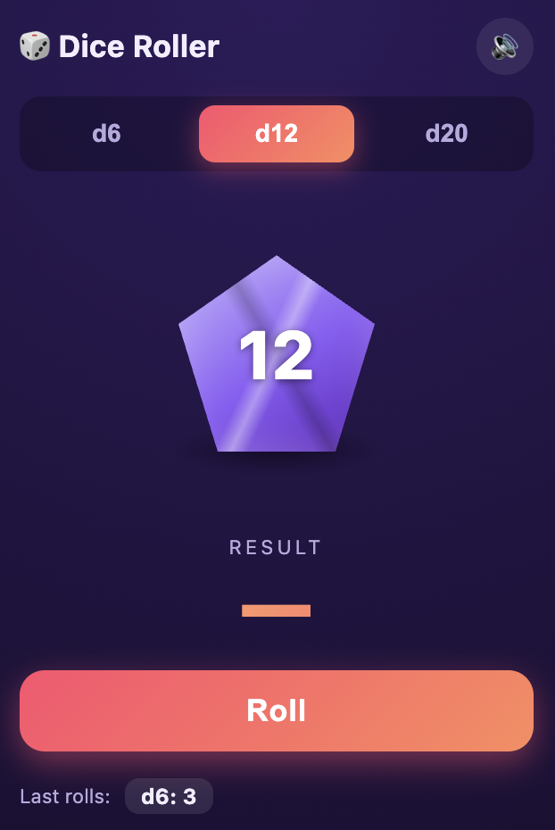
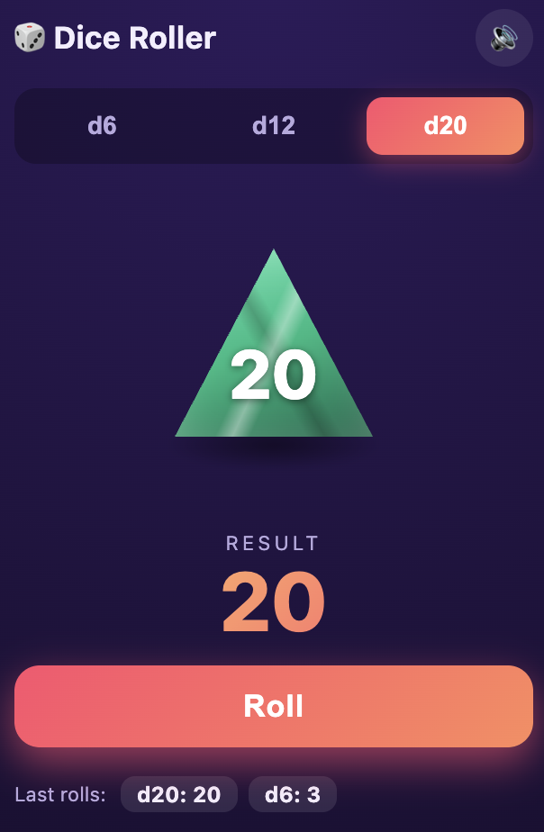

<div align="center">

# 🎲 Dice Roller 3D

**A Chrome extension for rolling animated 3D dice — right from your toolbar.**

  

[](https://developer.chrome.com/docs/extensions/mv3/)
[](https://developer.mozilla.org/en-US/docs/Web/JavaScript)
[](https://developer.mozilla.org/en-US/docs/Web/CSS/transform)
[](package.json)

</div>

---

## What is this?

Dice Roller 3D is a lightweight Chrome extension that puts a polished dice roller one click away. Pick your die type, hit **Roll** (or press Space/Enter), and watch it tumble with a satisfying clatter. No frameworks, no build step, no tracking — just a single popup built with HTML, CSS 3D transforms, and vanilla JS.

---

## Features

- **True 3D cube for d6** — CSS `transform-style: preserve-3d` with six individually rendered faces showing real pip layouts, not just a flat image
- **Distinct polyhedral shapes** — d12 renders as a **pentagon** (violet), d20 as a **triangle** (emerald), each with its own unique tumble animation
- **Physics-inspired animations** — parabolic arc, multi-axis rotation, and natural deceleration on landing
- **Sound effects** — white-noise clatter while rolling + a clean ding on the result, generated entirely via WebAudio (no audio files)
- **Mute toggle** — persisted across sessions via `localStorage`
- **Auto-roll on open** — greets you with motion every time the popup opens
- **Roll history** — last 6 results shown as pills at the bottom
- **Keyboard support** — `Space` or `Enter` to roll
- **Zero dependencies** — no npm, no bundler, no external libraries

---

## Die Types

| Die | Shape | Color | Faces |
|-----|-------|-------|-------|
| **d6** | 3D Cube | White / Lavender | 6 — pip dots on each face |
| **d12** | Pentagon | Violet / Purple | 12 — spins with X-axis tilt |
| **d20** | Triangle | Emerald / Green | 20 — faster arc, Y-axis wobble |

---

## Installation

> No Chrome Web Store listing yet — load it unpacked in developer mode.

1. [Download or clone this repo](https://github.com/OvalStudio/dice-roller-3d)
2. Open Chrome and go to `chrome://extensions`
3. Enable **Developer mode** (toggle in the top-right corner)
4. Click **Load unpacked**
5. Select the `dice-roller` folder
6. Pin the 🎲 icon from the puzzle-piece Extensions menu

---

## Usage

| Action | How |
|--------|-----|
| Roll the die | Click **Roll** button |
| Roll with keyboard | Press `Space` or `Enter` |
| Switch die type | Click **d6**, **d12**, or **d20** at the top |
| Toggle sound | Click the 🔊 / 🔇 icon |
| View roll history | See the pills at the bottom of the popup |

---

## Project Structure

```
dice-roller/
├── manifest.json       # Chrome Extension config (Manifest V3)
├── popup.html          # Extension popup markup
├── popup.css           # All styles — layout, 3D transforms, animations
├── popup.js            # Dice logic, WebAudio, roll history
├── docs/
│   └── preview.png     # Screenshot for README
└── icons/
    ├── icon16.png
    ├── icon48.png
    └── icon128.png
```

---

## How it works

**d6 — CSS 3D cube**

Six `<div class="face">` elements are individually transformed with `rotateY/rotateX` + `translateZ(42px)` to form the six sides of a real cube inside a `transform-style: preserve-3d` container. Pip dots are placed in a 3×3 CSS grid on each face — the correct layout for every value (1–6) is encoded in a `PIP_MAP` lookup.

**d12 / d20 — clip-path polygons**

A single `<div class="poly-body">` switches `clip-path` between a pentagon (d12) and a triangle (d20) via CSS classes toggled in JS. A `::before` pseudo-element with two crossed linear-gradients gives each shape a faceted highlight.

**Animations**

Each die type has a dedicated `@keyframes` block with 9–10 hand-tuned keyframes:
- `tumble` (d6) — true 3D rotation on X and Y axes
- `spinD12` — slower arc, X-axis tilt, 540° spin
- `spinD20` — higher arc (−68 px peak), Y-axis wobble, 760° spin

**Sound**

WebAudio API only — no audio files shipped. Rolling plays 5 overlapping band-pass filtered noise bursts (clatter); landing plays a short triangle-oscillator ding.

---

## Built by

[Anurag Singh](https://github.com/OvalStudio) — Builder · Engineer

---

## License

MIT — do whatever you want with it.
